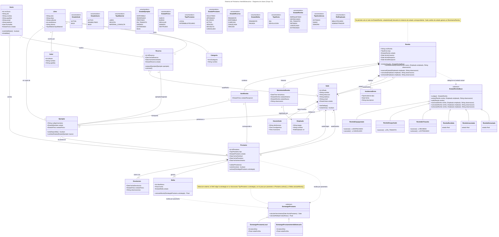

Desarrollo de Aplicaciones con Objetos 

FRC – UTN 

# **Trabajo práctico integrador** 

Documento de referencia de desarrollo 

## **1. Grupo** 

|Número de grupo:|71                            Tema: Biblioteca|
|---|---|
|Integrantes:||
|Legajo|Nombre|
|404034|Ferreyra, Martín|
|400137|Silberstein, Gaspar|
|403596|Germano, Francisco|

## **2. Propuesta** 

### **Objetivos del sistema** 

**Objetivo general.** Desarrollar un sistema orientado a objetos que permita a una red de bibliotecas públicas administrar sus sedes, socios, catálogo y ejemplares, y gestionar los préstamos locales e interbibliotecarios, incluido el envío de ejemplares entre sedes con trazabilidad mediante remito, reemplazando las tareas manuales actuales por un control centralizado y confiable. 

#### **Objetivos específicos** 

- Centralizar la administración de sedes, socios, catálogo y ejemplares físicos, evitando duplicados y registros inconsistentes. 

- Controlar el ciclo completo del préstamo, desde la solicitud (local o interbibliotecaria) hasta la devolución, validando disponibilidad del ejemplar, habilitación del socio, vencimientos y pertenencia del ejemplar a la sede de origen. 

- Garantizar la trazabilidad de cada ejemplar enviado entre sedes mediante remitos con historial de estados (empaquetado, despachado, en tránsito, recibido). 

- Facilitar al personal y a los socios la consulta de disponibilidad del catálogo por sede y la gestión de reservas. 

- Registrar las devoluciones junto con el estado físico del material y calcular las multas por vencimiento. 

- Proveer reportes de gestión sobre préstamos, material en tránsito, demanda de títulos y movimientos entre sedes que apoyen la toma de decisiones de la red. 

- Construir el sistema sobre un diseño orientado a objetos extensible, aplicando patrones de diseño, de modo que los procesos opcionales puedan incorporarse sin rehacer el modelo. 

Desarrollo de Aplicaciones con Objetos 

FRC – UTN 

### **Alcances** 

#### **Procesos obligatorios incluidos** 

- **Sedes:** alta, modificación y baja lógica de sedes (dirección, datos de contacto, horarios y estado activa/baja). 

- **Socios:** alta, modificación, baja e inhabilitación de socios, con control de duplicados por DNI y número de socio. 

- **Catálogo y ejemplares:** administración de libros y otros materiales de consulta, y de sus ejemplares físicos, cada uno asignado a la sede a la que pertenece. 

- **Solicitudes de préstamo:** registro de préstamos locales e interbibliotecarios, indicando sede origen y sede destino. 

- **Logística de ejemplares:** empaquetado, despacho y recepción de ejemplares con asignación de remito y trazabilidad por estados a lo largo del trayecto. 

- **Disponibilidad:** consulta de disponibilidad de ejemplares por título y por sede. 

- **Reservas:** alta, cancelación, vencimiento y asignación de un ejemplar cuando queda disponible. 

- **Devoluciones:** registro de la devolución y del estado físico del material devuelto, con generación de multa si corresponde. 

#### **Validaciones de negocio** 

- No prestar ejemplares que no estén disponibles. 

- No prestar material a socios inhabilitados. 

- Controlar las fechas de vencimiento de los préstamos. 

- Mantener la trazabilidad del remito durante todo el trayecto (cada cambio de estado queda registrado). 

- Evitar duplicados de socios, catálogo y ejemplares. 

- No prestar ejemplares que no pertenezcan a la sede de origen del préstamo. 

- No iniciar préstamos, reservas ni envíos desde o hacia una sede dada de baja. 

#### **Ciclo de vida del remito** 

EMPAQUETADO → DESPACHADO → EN_TRÁNSITO → RECIBIDO. Un remito puede pasar a CANCELADO solo antes del despacho y a EXTRAVIADO desde EN_TRÁNSITO. Las transiciones no permitidas se rechazan, y cada cambio genera un movimiento con fecha, estado anterior, estado nuevo y empleado responsable. La devolución de un préstamo interbibliotecario genera un remito de tipo DEVOLUCIÓN hacia la sede propietaria. 

#### **Reportes previstos** 

- Préstamos activos y material en tránsito. 

- Préstamos vencidos y multas acumuladas por socio. 

- Libros más solicitados para préstamos inter-sedes. 

- Disponibilidad de catálogo por sede. 

- Tasa de envíos exitosos e incidencias. 

- Movimiento de ejemplares entre sedes: envíos por sede origen/destino y tiempo promedio de tránsito. 

#### **Decisiones de diseño** 

- **Patrón State:** para el ciclo de vida del remito (empaquetado, despachado, en tránsito, recibido, cancelado, extraviado), donde cada estado define qué transiciones admite y rechaza las demás. Sigue el esquema visto en la cátedra: el remito es el contexto y el estado actual decide la transición.

- **Patrón Strategy:** para el cálculo del plazo de vencimiento y de la multa según el tipo de préstamo (local o interbibliotecario). La estrategia se elige desde afuera según el tipo, como se vio en clase.

- Se aplican exactamente dos patrones: no se implementan Singleton, Observer ni Factory Method. El estado del préstamo se resuelve con una enumeración y una tabla de transiciones permitidas validada al operar.

#### **Tecnologías y criterio de implementación**

- Python, SQLite con SQLAlchemy (estilo clásico, un DAO por entidad), interfaz de escritorio con Tkinter/ttk y pruebas con pytest.

- Todo el sistema se implementa únicamente con los conceptos y las formas de implementación vistas en la cátedra durante el año.

#### **Supuestos** 

- Cada ejemplar pertenece a una única sede; en un préstamo interbibliotecario viaja a la sede destino, donde lo retira el socio, y vuelve a su sede propietaria con un remito de devolución. 

- Un remito puede agrupar varios ejemplares entre el mismo par de sedes. 

- La reserva se realiza sobre un título y una sede de retiro, y se asigna a un ejemplar concreto cuando hay uno disponible. 

Desarrollo de Aplicaciones con Objetos 

FRC – UTN 

- Usuarios del sistema: el personal (empleados con rol) opera los procesos; los socios consultan disponibilidad y catálogo. 

#### **Fuera del alcance inicial** 

Los procesos opcionales (envío de notificaciones, historial de lecturas, recomendaciones, inventario con códigos y revisión detallada de la recepción por extravío, daño o destrucción) no se incluyen en la versión base y se evaluarán según el tiempo disponible. El modelo ya contempla puntos de extensión: el código de inventario del ejemplar, el estado físico y las incidencias de envío. Tampoco se incluyen el cobro de multas ni la autenticación avanzada: solo se registra el estado de la multa. 

### **DER o Diagrama de Clases UML** 

Versión editable en texto (Mermaid): `diagrama-clases.mmd`.

**Figura 1.** Diagrama de clases UML del sistema. Las asociaciones sedeOrigen y sedeDestino de Préstamo y Remito apuntan a la misma clase Sede. Incluye además la jerarquía de estados del remito (State) y la de estrategias de préstamo (Strategy). 

**Enumeraciones** 

- **EstadoSede:** ACTIVA, BAJA 

Desarrollo de Aplicaciones con Objetos 

FRC – UTN 

- **EstadoSocio:** ACTIVO, INHABILITADO, BAJA 

- **TipoMaterial:** LIBRO, REVISTA, MATERIAL_CONSULTA 

- **EstadoEjemplar:** DISPONIBLE, RESERVADO, PRESTADO, EN_TRANSITO, DANADO, EXTRAVIADO, BAJA 

- **EstadoFisico:** NUEVO, BUENO, REGULAR, DANADO, DESTRUIDO 

- **TipoPrestamo:** LOCAL, INTERBIBLIOTECARIO 

- **EstadoPrestamo:** SOLICITADO, APROBADO, EN_ENVIO, ACTIVO, VENCIDO, DEVUELTO, CANCELADO 

- **EstadoReserva:** PENDIENTE, DISPONIBLE, CUMPLIDA, CANCELADA, VENCIDA 

- **EstadoMulta:** PENDIENTE, PAGADA 

- **TipoEnvio:** IDA, DEVOLUCION 

- **EstadoRemito:** EMPAQUETADO, DESPACHADO, EN_TRANSITO, RECIBIDO, CANCELADO, EXTRAVIADO 

- **TipoIncidencia:** EXTRAVIO, DANIO, DEMORA 

- **RolEmpleado:** BIBLIOTECARIO, ADMINISTRADOR 

#### **Notas del modelo** 

- Libro representa el título del catálogo y Ejemplar la copia física; la disponibilidad se controla sobre el ejemplar. 

- La regla de pertenencia se valida comparando la sede del ejemplar con la sedeOrigen del préstamo. 

- ItemRemito vincula cada ejemplar enviado con el préstamo que lo originó, y MovimientoRemito guarda el historial de estados del remito. 

- Patrón State: `Remito` es el contexto y delega en su estado actual (`EstadoRemitoBase` y una clase por estado), que define qué transiciones admite. Solo se persiste el código del estado.

- Patrón Strategy: el DAO (`PrestamoDAO` o `RemitoDAO`) elige la `EstrategiaPrestamo` según el tipo (diccionario `ESTRATEGIAS`) y se la pasa por parámetro a `Prestamo.activar()` y a `Multa.calcularMonto()`. Ni `Prestamo`, ni `Multa`, ni los estados del remito eligen la estrategia.
